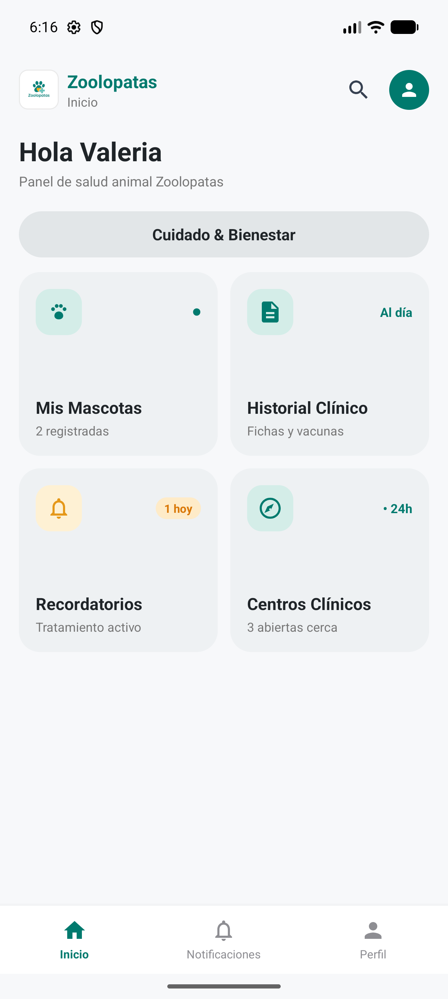
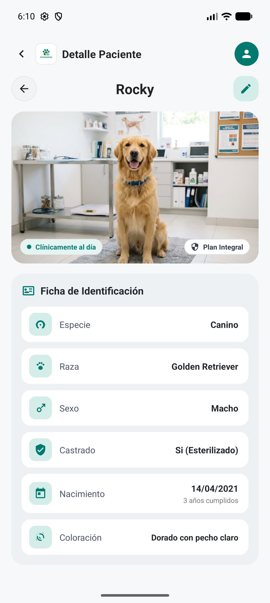
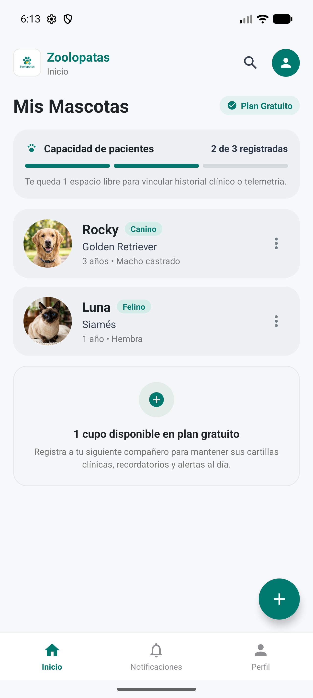
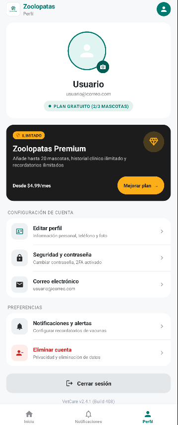

# 🐾 Zoolopatas - Gestión del Historial Clínico Mascotas

Zoolopatas es una aplicación móvil nativa para Android enfocada en el bienestar, cuidado animal y centralización del historial clínico de mascotas (perros y gatos). 

## 📱 Características Principales
*   **Autenticación Segura:** Registro e inicio de sesión con validación de correo electrónico.
*   **Perfiles de Usuario:** Personalización de datos del dueño y foto de perfil.
*   **Gestión de Mascotas:** Registro de datos biológicos, foto, esterilización y más.
*   **Historial Clínico:** Control de vacunas, desparasitaciones, enfermedades, medicamentos y revisiones.
*   **Recordatorios:** Alertas para futuras dosis y citas veterinarias.

## 🛠️ Tecnologías y Herramientas
*   **Lenguaje:** Java (Android Nativo).
*   **Interfaz Gráfica:** XML Layouts con ConstraintLayout y Material Design 3.
*   **Base de Datos:** Cloud Firestore (NoSQL) con reglas de seguridad.
*   **Autenticación:** Firebase Authentication.
*   **Almacenamiento de Imágenes:** Supabase Storage (gestión de avatares y fotos de mascotas).
*   **Carga de Imágenes:** Glide.

## 📁 Estructura del Proyecto
*   `/app/src/main/java/com/example/ProyectoZoloopatas/`: Código fuente (Activities, Modelos, Helpers).
*   `/app/src/main/res/layout/`: Vistas y pantallas de la interfaz.
*   `/app/src/main/res/drawable/`: Recursos visuales (íconos vectoriales, fondos).

## 🚀 Instalación y Ejecución
1. Clona este repositorio: `git clone https://github.com/zakf4-blip/ProyectoZoloopatas.git`
2. Abre el proyecto en **Android Studio**.
3. Sincroniza Gradle (`Sync Now`).
4. Ejecuta la aplicación en un emulador o dispositivo físico con Android 7.0 (API 24) o superior.

## 📸 Capturas de Pantalla

| Pantalla de Inicio | Información de Mascota |
|:---:|:---:|
|  |  |

| Mis Mascotas | Verificación de Cuenta |
|:---:|:---:|
|  |  |

> **Nota:** El proyecto requiere un archivo `google-services.json` propio (no incluido en el repositorio por seguridad) para conectarse a la base de datos de Firebase.
